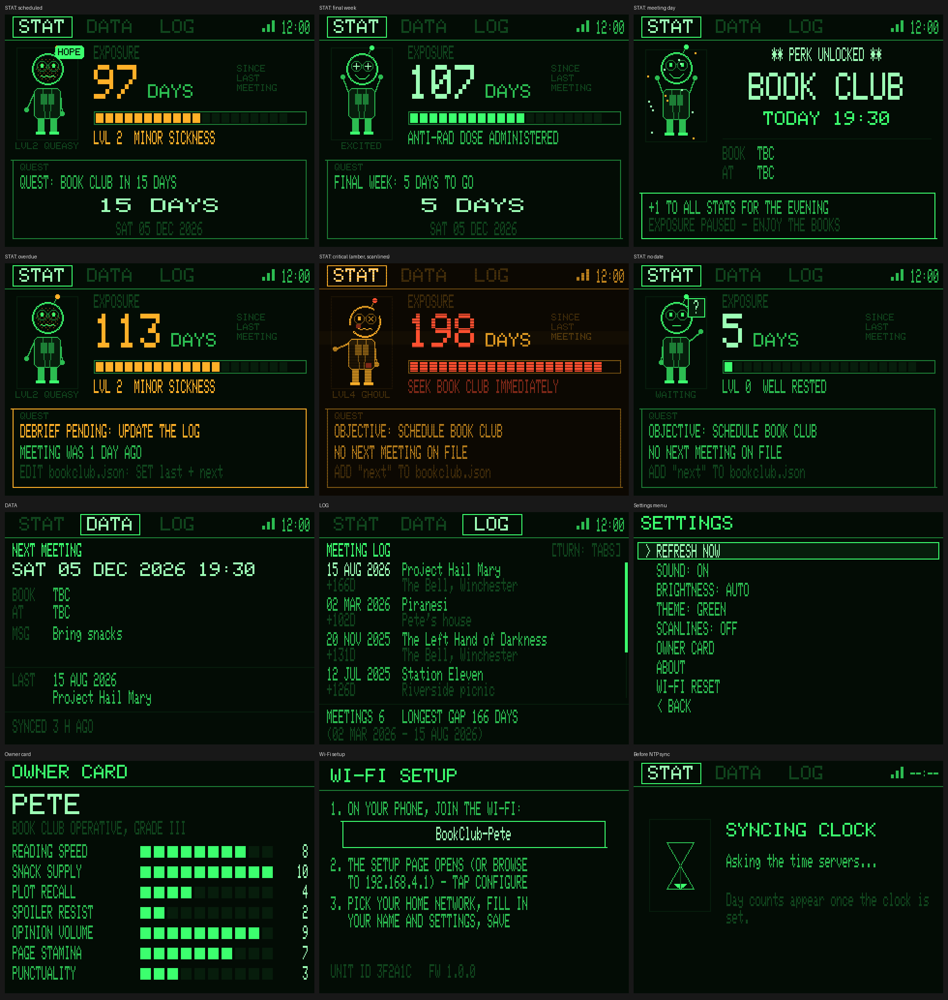

# Book-Club 3000

A desk terminal that shows how long it has been since the club last met (your
"exposure") and counts down to the next meeting (the "quest"). Every unit reads
the same file, [`bookclub.json`](bookclub.json), from this repo.



```
bookclub.json   the shared dates file — edit this one
firmware/       the PlatformIO project for the ESP32 "Cheap Yellow Display"
art/            mascot art: PNGs you draw, baked into the firmware (art/README.md)
tools/          check_bookclub.py (the same checks the units apply), art tools
docs/           the original handover/spec
case/           (to come) STL files for the printed case
```

## Updating the dates (everyone)

Open [`bookclub.json`](bookclub.json) on GitHub, click the pencil, edit, and
commit. Every unit picks it up within 24 hours, or straight away from the
knob menu: **hold 2 s → REFRESH NOW**. GitHub may serve the old copy for a few
minutes after an edit.

```json
{
  "version": 1,
  "last": { "date": "2026-08-15", "plan": "Retro games + curry", "location": "Pete's house" },
  "next": { "date": "2026-12-05", "time": "19:30", "plan": "Film night + pizza", "location": "TBC" },
  "history": [
    { "date": "2026-08-15", "plan": "Retro games + curry", "location": "Pete's house" },
    { "date": "2026-03-02", "plan": "Pub, then co-op games", "location": "The Bell, Winchester" }
  ],
  "side_quests": [],
  "fun_caps": {},
  "message": "Bring snacks"
}
```

- Dates are `YYYY-MM-DD`, times are 24-hour `HH:MM`, both UK local time.
- **After a meeting:** set `last` to that meeting, add the same entry to the
  top of `history`, and set `next` to the new date, or to `null` if there
  isn't one yet. Until `last` changes, the exposure counter keeps counting
  and the unit shows **DEBRIEF PENDING**.
- **Side quests** are get-togethers that aren't a proper club meeting, like
  the families coming along. List them in `side_quests`, each with a
  `date` and optionally `time`, `plan` and `location`:

  ```json
  "side_quests": [
    { "date": "2026-12-20", "time": "14:00", "plan": "Xmas do with the families", "location": "Pete's house" }
  ],
  ```

  The next one shows as a countdown on STAT and in full on DATA, and on the
  day the unit reassures you that no Fun Caps are being spent. They
  **never reset the exposure counter**: only a proper meeting in `last`
  does. Past side quests stay in the LOG, marked as side quests, but don't
  count towards the meeting total or the longest gap. Leave old ones in the
  list or delete them, either is fine.
- **Fun Caps** are the club's joke currency of goodwill from home, shown on
  each unit's owner card (hold the knob 2 s → OWNER CARD). Everyone earns
  **1 cap per fortnight** at home, up to **10**; each proper club night
  costs **3** (side quests are free). The balance is worked out from the
  meeting history, so it needs no upkeep and every unit agrees. To award a
  bonus or a penalty, add the person's name (as set on their unit) to
  `fun_caps`, with a whole number or a number and a reason:

  ```json
  "fun_caps": {
    "Pete": { "adjust": 2, "note": "Did the school run" },
    "Dave": -3
  },
  ```

  Adjustments are running totals: change the number rather than adding new
  entries. A balance can drop to -5 (overdrawn, in the doghouse). The rules
  live in `CapsRules` in `firmware/lib/bookclub_state/src/bc_state.h`.
- `plan` is what's on (games, a film, food, the pub...) and shows on the
  DATA and LOG tabs. `next`, `time`, `plan`, `location` and `message` are
  all optional. Older files that say `book` instead of `plan` still work.
- If an edit breaks the file, the **Check bookclub.json** action shows a red
  cross on the commit, and the units ignore the broken version and keep
  showing the last good one. Fix it and they pick it up on the next sync.
  To check locally: `python3 tools/check_bookclub.py`.

## Setting up a unit (each friend)

1. Plug it in. With no Wi-Fi saved it shows **WI-FI SETUP** and a network
   name like `BookClub-3F2A1C`.
2. Join that network on your phone. A setup page opens (or browse to
   `192.168.4.1`) — tap **Configure WiFi**.
3. Pick your home network, enter its password, and fill in your name, theme
   (`green` or `amber`), the seven owner-card stats, and the screen rotation.
   Leave the data URL as it is. Save.

The unit joins your network, sets its clock and fetches the file. If your
Wi-Fi drops it carries on counting from the dates it already has and keeps
retrying in the background.

**Knob:** turn to switch between STAT, DATA and LOG. On LOG, press to switch
between changing tabs and scrolling. Hold 2 s for settings (refresh, sound,
brightness, theme, scanlines, owner card, about, Wi-Fi reset).
**Factory reset:** hold the BOOT button while plugging in, for 10 seconds.

Firmware details, the bring-up checklist and the release process are in
[`firmware/README.md`](firmware/README.md).
