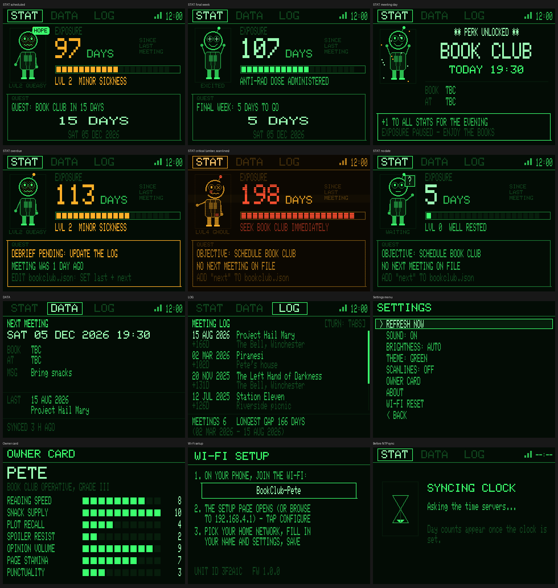

# Book-Club 3000

A desk terminal that shows how long it has been since the club last met (your
"exposure") and counts down to the next meeting (the "quest"). Every unit reads
the same file, `bookclub.json`, from a secret GitHub gist that the club shares.



```
bookclub.example.json   what the club file looks like (the real one is in the gist)
firmware/       the PlatformIO project for the ESP32 "Cheap Yellow Display"
art/            mascot art: PNGs you draw, baked into the firmware (art/README.md)
tools/          club_editor.py (edit the club file), check_bookclub.py, art tools
worker/         the nudge hub: a small Cloudflare Worker (worker/README.md)
docs/           the original handover/spec; SUCCESSION.md for taking over
case/           (to come) STL files for the printed case
```

## Updating the dates

The club file lives in a **secret gist**, not in this repo, so the meeting
details stay out of public view. Ask Pete for its link, and don't post it
anywhere public. Only the gist's owner can edit it: open the gist, click
**Edit**, change
`bookclub.json`, and click **Update secret gist**. Every unit picks it up
within 24 hours, or straight away from **settings → REFRESH NOW**. GitHub may
serve the old copy for a few minutes after an edit.

A secret gist isn't listed or searchable, but anyone with the link can read
it, so treat the link like a spare key. Gists have no collaborators, so
everyone else sends their changes to the owner.

**The easy way (gist owner):** `python3 tools/club_editor.py` opens a form
in your browser with every field: next meeting, a button for "the
next meeting happened", side quests, Fun Caps, history and the
firmware update block. It checks each change with the units' own rules and
won't save a file they would reject. It needs the GitHub CLI signed in as
the gist's owner (`gh auth login`). The first run asks for the gist's link
and remembers it in `.bookclub-gist`, which git ignores. The page only
runs on your computer.

```json
{
  "version": 1,
  "next": { "date": "2026-12-05", "time": "19:30", "plan": "Film night + pizza", "location": "TBC" },
  "history": [
    { "date": "2026-08-15", "plan": "Retro games + curry", "location": "Pete's house" },
    { "date": "2026-03-02", "plan": "Pub, then co-op games", "location": "The Bell, Winchester" }
  ],
  "side_quests": [],
  "fun_caps": {},
  "birthdays": {}
}
```

- Dates are `YYYY-MM-DD`, times are 24-hour `HH:MM`, both UK local time.
- **After a meeting:** add it to the top of `history`, and set `next` to the
  new date, or to `null` if there isn't one yet. The newest entry in
  `history` is the last meeting: until a new one goes in, the exposure
  counter keeps counting and the unit shows **DEBRIEF PENDING**.
- **`last`** is only needed by units before firmware 1.5.30, which reject a
  file without it. Newer units use it if it's there, else the newest
  `history` entry. Once UNITS on the hub page shows every unit on 1.5.30 or
  later, delete it.
- **Side quests** are get-togethers that aren't a proper club meeting, like
  the families coming along. List them in `side_quests`, each with a
  `date` and optionally `time`, `plan` and `location`:

  ```json
  "side_quests": [
    { "date": "2026-12-20", "time": "14:00", "plan": "Xmas do with the families", "location": "Pete's house" }
  ],
  ```

  The next one shows as a countdown on STAT and in full on DATA, and on the
  day the unit reassures you that no Fun Caps are being spent. They
  **never reset the exposure counter**: only a proper meeting in `history`
  does. Past side quests stay in the LOG, marked as side quests, but don't
  count towards the meeting total or the longest gap. Leave old ones in the
  list or delete them, either is fine.
- **Fun Caps** are the club's joke currency of goodwill from home, shown on
  each unit's owner card (hold the knob 2 s → THIS UNIT → OWNER CARD). Everyone earns
  **1 cap per fortnight** at home, up to **10**; each proper club night
  costs **3** (side quests are free). The balance is worked out from the
  meeting history, so it needs no upkeep and every unit agrees. To award a
  bonus or a penalty, add the person's name (as set on their unit) to
  `fun_caps`, with a whole number or a number and a reason:

  ```json
  "fun_caps": {
    "Pete": { "adjust": 2, "note": "Did the school run" },
    "Dave": -3
  },
  ```

  Adjustments are running totals: change the number rather than adding new
  entries. A balance can drop to -5 (overdrawn, in the doghouse). The rules
  live in `CapsRules` in `firmware/lib/bookclub_state/src/bc_state.h`.
- **Birthdays** go in `birthdays`, as `"MM-DD"` or a full `"YYYY-MM-DD"`
  (the year isn't used), under each person's name as set on their unit:

  ```json
  "birthdays": { "Pete": "03-14", "Dave": "1984-10-22" },
  ```

  On the day, every unit puts the mascot in his party hat and says whose
  birthday it is; the birthday person's own unit says "HAPPY BIRTHDAY" and
  plays the jingle once (outside quiet hours). A club meeting on the same
  day still gets its own celebration. A 29 February birthday is marked on
  28 February in other years. The DATA tab always shows whose birthday is
  next, e.g. `BDAY  DAVE  22 OCT (12D)`.
- `plan` is what's on (games, a film, food, the pub...) and shows on the
  DATA and LOG tabs. `next`, `time`, `plan` and `location` are
  all optional. Older files that say `book` instead of `plan` still work.
- If an edit breaks the file, the units ignore the broken version and keep
  showing the last good one; **ABOUT** shows why it was rejected. Fix it and
  they pick it up on the next sync. To check an edit first, run
  `python3 tools/check_bookclub.py <the gist's Raw link>`.

## Setting up a unit (each friend)

1. Plug it in. With no Wi-Fi saved it shows **WI-FI SETUP** and a network
   name like `BookClub-3F2A1C`.
2. Join that network on your phone. A setup page opens (or browse to
   `192.168.4.1`) — tap **Configure WiFi**.
3. Pick your home network, enter its password, and fill in your name, theme
   (`green` or `amber`), the seven owner-card stats, the screen rotation, and
   your **Nudge token** if you've been given one.
   For **Data file URL**, paste the gist's **Raw** link (open the gist, click
   **Raw**, copy the address, then delete the long code between `/raw/` and
   `/bookclub.json` so it always gets the latest version). Save.

The unit joins your network, sets its clock and fetches the file. If your
Wi-Fi drops it carries on counting from the dates it already has and keeps
retrying in the background.

**Touch screen:** tap STAT, DATA, LOG or SET to switch tabs, tap the clock (or the SET tab) for
settings, tap the mascot for your owner card (tap a stat there for its own
page), and tap a screen's title to go
back. On LOG, tap the top or bottom half of the list to page through it. A
stylus works best.
**Knob:** everything works with the knob alone. Turn to switch between STAT,
DATA, LOG and SET. On SET, press for settings; every list ends in **< BACK**.
On STAT, press for your owner card: turn to pick a stat and press for its
page, or turn onto **< BACK** (top right) and press to leave. On LOG, press to
switch between changing tabs and scrolling. On DATA, press for **SYNC STATUS**:
if a ⚠ shows by the clock, it says what went wrong fetching the club file (a
typo in the gist, a firmware update that couldn't install, no Wi-Fi...) and
what to do, with a REFRESH NOW button. Tapping the ⚠ opens it too. A 2 s hold is a shortcut: it opens
settings from the tabs and goes back from anywhere else (in a settings group,
up one level). Settings has refresh, send nudge, signals and send from phone,
then three groups:

- **SCREEN >** brightness, theme, scanlines, screen off at night, dim when
  idle, dark room off
- **SOUND >** sound, volume, quiet hours
- **THIS UNIT >** owner card, knob direction, how to use, about, Wi-Fi reset

If a knob turns the wrong way, set **THIS UNIT → KNOB: REVERSED** rather than
re-soldering it.
**The screen** switches itself off at night (23:00–07:00 by default) and dims
after 30 minutes untouched; turn the knob or tap to wake it. It can also
switch off after 10 minutes in a dark room (**DARK ROOM OFF**: never, very dark
or dark), but that is off by default: the light sensors read very differently
from unit to unit. All three are in **SETTINGS → SCREEN**. It's an LCD, so it
can't burn in, but this saves its backlight, which slowly wears with use.
**Factory reset:** hold the BOOT button while plugging in, for 10 seconds.
**Staying up:** each unit restarts itself quietly once a day between 03:00
and 05:00 when nobody's using it, and sooner if its memory gets too
fragmented for secure connections. Both are silent and normal. **SETTINGS →
THIS UNIT → ABOUT** shows why it last started; WATCHDOG, CRASH or BROWNOUT there (in
amber) is a real problem worth reporting, along with the MEMORY line.

## Nudges

Poke a friend from your desk: **SETTINGS → SEND NUDGE**, pick a friend (or
EVERYONE), then a message. It lands on their unit within 5 minutes, with a
chirp, a flashing blue light and the message in big letters until they press
or tap. In quiet hours (22:00–08:00 unless changed in **SETTINGS → SOUND → QUIET HOURS**) it arrives silently and waits on screen.

**Replying** (from 1.5.25): turn the knob while a friend's nudge is on screen
to pick a reply (*ON MY WAY*, *5 MINS*, *LATER*, *NOT TONIGHT*, *NO.*, *LOL*,
*YOU WISH*, *LEAVE ME ALONE*) and press to send it; with none picked, a press
just dismisses it. On the touch screen, tap the **<** and **>** at the bottom
to pick and the middle to send. A reply arrives as **REPLY FROM …** and can't
be replied to, so nobody gets stuck in a loop. It counts towards the same
rate limit as nudges.

The built-in messages include *GET YOUR ASS ONLINE*, *THINKING OF YOU,
LOSER*, *WHERE ARE YOU, COWARD?* and *I'M ON. YOU'RE NOT. SHAME.* To use the
club's own in-jokes instead, add them under **NUDGES** in the club editor
(up to 16, 40 characters each).

Nudges go through a small hub that one person sets up once on a free
Cloudflare account: see [`worker/README.md`](worker/README.md). They then put
the hub's address in the club file and give each friend their own token for
the setup page.

## Signals

A signal from the wasteland: a quote you broadcast to every unit in the club.
It stays on the air for 24 hours, then it's gone for good.

**SETTINGS → SIGNALS** shows what's on the air, one quote at a time, with
who sent it and a signal-strength bar that fades as its 24 hours run out.
Turn past the last one to **BROADCAST YOURS**, press, turn to pick a quote and
press to send. Each person gets one signal a day (the day starts at midnight,
UK time), from their unit or the web page below; the next day's replaces it. When a friend's new signal arrives,
units tune in with a sweep of the radio dial and show it until someone presses
or taps. In quiet hours it arrives silently. STAT mentions what's on the air,
and tapping that line opens the signals.

The built-in quotes come from books old enough to belong to everyone
(Shelley's *Ozymandias*, Coleridge, Dickinson, Shakespeare...), plus a few
dispatches like *STILL ALIVE OUT HERE. BARELY. SEND SNACKS.* To use the club's
own, add them under **SIGNALS** in the club editor (up to 16, 100 characters
each), or in the gist:

```json
"signals": { "quotes": ["Not all who read are lost.", "Bring the good biscuits."] }
```

## From a phone

The hub has its own web page, at the address it was deployed to (the one in
the club file, e.g. `https://bookclub-nudge.<something>.workers.dev`). Sign
in with your nudge token, then send a nudge or broadcast a signal **in your
own words**: nudges up to 40 characters, signals up to 100. The same limits
apply as on the units. To skip typing the address and the token, scan the
QR code in **SETTINGS → SEND FROM PHONE** on your unit: it carries the unit's
token, so the page signs straight in as that unit (and remembers it on that
phone). Only let friends scan it. A unit without a token shows the plain page. It also shows what's on the air. Tick *Remember on
this phone* to stay signed in; the hub owner can also send someone a link
that signs them in, `https://…workers.dev/#t=<their token>` (keep it private:
it's as good as the token).

**UNITS** at the bottom of the page lists every unit the hub knows: its
firmware version, whether it's online or when it was last seen, how long
it's been up, and why it last started. Anything amber needs a look: an older
version than the rest, **ON PROBATION**, a rollback, or a crash, watchdog or
brownout. Use it to check a release without asking around. Units report in
from 1.5.25, and the times can be up to half an hour behind, to keep the hub
inside Cloudflare's free plan.

Signals use the nudge hub, so they need the same setup. A hub set up before
signals existed needs redeploying once (`npx wrangler deploy` in `worker/`);
until then units show **NO SIGNAL: the hub needs updating for signals**.

Firmware details, the bring-up checklist and the release process are in
[`firmware/README.md`](firmware/README.md).
