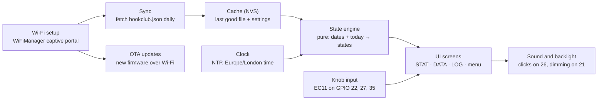

# Book-Club 3000 — Firmware Handover

Nov 10, 2026

## Overview

Build the firmware for the Book-Club 3000: a desk terminal that shows how long it has been since a group of friends last met for "Book Club", and counts down to the next meeting. It runs on an ESP32-2432S028R "Cheap Yellow Display" in a 3D-printed retro case, with a rotary knob for input. The friends meet every 3 to 6 months.

The device has a retro-futuristic, radiation-themed personality. Time since the last meeting is "exposure": the longer it gets, the sicker the on-screen mascot looks. The next meeting is a "quest": unset, it nags for a date; set, it becomes a countdown.

**Fleet:** 3 or 4 identical units, one per friend, all reading the same dates from one shared file. Each unit has its own owner name and colour theme.

**Definition of done:**

- A unit set up from scratch joins Wi-Fi from a phone, with no code changes or USB cable.
- Editing the shared dates file updates every unit within 24 hours, or immediately on a manual refresh.
- The screen shows the correct exposure level and quest state for any combination of dates, including no next date, a past next date and the meeting day itself.
- The knob moves between the three tabs; nothing needs the touch screen.
- Firmware updates install over Wi-Fi.
- A unit with no Wi-Fi keeps counting from its last known dates.

**IP constraint:** the look is inspired by retro sci-fi terminals, but the firmware must contain no Fallout or Bethesda assets: no Vault Boy, no Pip-Boy logo or wordmark, no copied game fonts, screens or sound files. The mascot, icons and sounds are original.

## Hardware

The board is the ESP32-2432S028R ("CYD"), USB-C revision, sold by AITRIP: an ESP32-WROOM-32 with a 2.8" 320 × 240 TFT, resistive touch, micro-SD, RGB LED, light sensor and a speaker amplifier. It is powered from 5 V USB only. Pin assignments below are the commonly documented ones for this board; confirm them against the unit in hand.

| Function | GPIO | Notes |
| --- | --- | --- |
| TFT (SPI) | 2 DC, 12 MISO, 13 MOSI, 14 SCK, 15 CS | HSPI bus |
| TFT backlight | 21 | PWM for dimming |
| Touch, XPT2046 | 25 CLK, 32 MOSI, 39 MISO, 33 CS, 36 IRQ | Not used in v1 |
| Speaker | 26 | Through the on-board PAM8002A amp |
| RGB LED | 4 red, 16 green, 17 blue | Active low |
| Light sensor (LDR) | 34 | Analogue in, for auto-dimming |
| Encoder A | 22 | Free pin on the JST header |
| Encoder B | 27 | Free pin on the JST header |
| Encoder push switch | 35 | Input only, no internal pull-up: needs an external 10k to 3.3 V |
| BOOT button | 0 | Can double as a factory-reset hold |

**Peripherals per unit:** an EC11 rotary encoder with push switch (a 20 mm shaft clears the case's dial collar), a 10k resistor, and optionally a small 8 Ω speaker on the speaker connector.

**Gotchas the agent must handle:**

- **Display driver varies by revision.** The original board uses an ILI9341; USB-C revisions often use an ST7789. Make the driver a build flag and check which one the first board needs: wrong colours or a garbled screen means the wrong driver or the wrong colour inversion.
- **Screen rotation.** In the case, the board sits with the USB-C socket on the left and the JST connectors at the top. Make rotation a config value and confirm the correct one on the first board.
- **Pins are fully used.** With the encoder wired, no free GPIOs remain. Do not plan features that need more physical inputs.
- **Speaker noise.** GPIO 26 also drives the amp's input; keep it low when silent to avoid hiss.

## Data source

All units read one JSON file, `bookclub.json`, kept in a shared GitHub repo that every friend can edit, usually in GitHub's web editor. There is no server: a unit fetches the file's raw URL over HTTPS.

```json
{
  "version": 1,
  "last": { "date": "2026-08-15", "book": "Project Hail Mary", "location": "The Bell, Winchester" },
  "next": { "date": "2026-12-05", "time": "19:30", "book": "TBC", "location": "TBC" },
  "history": [
    { "date": "2026-08-15", "book": "Project Hail Mary", "location": "The Bell, Winchester" },
    { "date": "2026-03-02", "book": "Piranesi", "location": "Pete's house" }
  ],
  "message": "Bring snacks"
}
```

The book titles and places above are placeholders.

**Field rules:**

- `next` may be `null`, or omitted, when no date is set. `next.time`, `book`, `location` and `message` are all optional.
- Dates are `YYYY-MM-DD` and times `HH:MM`, both local UK time (Europe/London, with daylight saving).
- `history` is newest first and feeds the LOG tab. `last` should match its first entry; if they disagree, `last` wins.
- Unknown fields are ignored, so the schema can grow without breaking older firmware.

**Fetch and cache:**

- Fetch on boot, then once every 24 hours, plus on demand from a menu action. Add a random delay of up to 30 minutes to the daily fetch.
- Store the last good file in NVS (non-volatile storage). Use the cached copy on boot until a fetch succeeds.
- Reject a fetched file that fails to parse or has no valid `last.date`, and keep the cached copy.
- Show a small "last synced" age on the DATA tab, and a warning icon after 7 days without a successful sync.
- The raw-file host may serve a cached copy for a few minutes after an edit; that delay is acceptable.

**Repo access:** if the repo is public, fetch the raw URL directly. If private, use a read-only fine-grained GitHub token stored in config and sent as an `Authorization` header, never committed to the repo. Pete decides which (see Open questions).

**Time:** get the time from NTP once Wi-Fi is up, with a POSIX timezone string for Europe/London, so day counts and the meeting-day check flip at local midnight.

## State model

The screen combines two independent states, computed from the dates and today's local date: an **exposure level** from days since `last`, and a **quest state** from `next`. Put both in one pure function with no hardware calls, so it can be unit-tested on a PC.

**Exposure levels**, from whole days since `last.date`. Thresholds live in one config table so they can be tuned.

| Level | Days since last | Mascot | Screen mood |
| --- | --- | --- | --- |
| 0 Well rested | 0 to 13 | Thumbs up, grinning | Exposure bar near empty |
| 1 Healthy | 14 to 89 | Idle, occasional blink | Bar creeping up |
| 2 Minor sickness | 90 to 136 | Queasy, green tinge | Amber warning label |
| 3 Advanced sickness | 137 to 182 | Slumped, limbs flagging | Occasional Geiger clicks |
| 4 Critical | 183 or more | Mid-transformation into a ghoul | "SEEK BOOK CLUB IMMEDIATELY", faster clicks |

The exposure bar fills linearly from 0 at day 0 to full at day 183, and stays full beyond it.

**Quest states**, checked in this order:

| State | Condition | Shows |
| --- | --- | --- |
| Meeting day | `next.date` is today | Celebration screen, "perk unlocked" style, overrides everything else |
| Final week | `next.date` is 1 to 7 days away | Countdown with excited mascot; exposure shown as "anti-rad dose administered" |
| Scheduled | `next.date` is 8 or more days away | Countdown in days; mascot keeps its exposure look, with a hopeful badge |
| Overdue | `next.date` is in the past and the file still lists it | "Debrief pending": prompts someone to update the file; exposure keeps counting from `last` |
| No date | `next` missing or null | "Objective: schedule Book Club" or "Awaiting orders from the Overseer" |

**Edge cases:**

- **Meeting day, then nothing changes.** Exposure must not reset by itself: only an edit to `last` resets it. The day after a meeting with no file update shows Overdue.
- **Countdown wording.** Under 2 days, show hours as well as days; on the day, show the meeting time if `next.time` is set.
- **No valid time yet.** Before the first NTP sync, show a "syncing clock" screen, not wrong numbers.
- **Bad data.** A `next.date` before `last.date` is treated as No date. A `last.date` in the future clamps exposure to 0.

## UI

The interface is a monochrome phosphor terminal at 320 × 240 with three tabs, driven entirely by the knob.

**Tabs:**

| Tab | Content |
| --- | --- |
| STAT | Mascot sprite in its current state, exposure in days, the exposure bar and level label, and the quest line (countdown or "schedule Book Club") |
| DATA | Next meeting: date, time, book, location, and the optional message; last meeting's book; last-synced age |
| LOG | Past meetings from `history`, newest first, scrolling; summary lines for total meetings and the longest gap between them |

**Knob controls:**

- **Turn:** move between tabs; on LOG, scroll the list.
- **Short press:** on LOG, toggle between tab-switching and scrolling. Elsewhere, wake the screen.
- **Long press (2 s):** open a settings menu: Refresh now, Sound on/off, Brightness auto/fixed, Theme colour, Owner card, About (firmware version, IP, last sync), Wi-Fi reset.
- **BOOT button held for 10 s at power-on:** factory reset, clearing Wi-Fi and settings.

The owner card is a fun profile page with the unit's owner name and a joke set of seven stats, each 1 to 10, set in config.

**Visual style:**

- One accent colour on near-black, plus dimmer and brighter shades of it: green (#3CFF6E) or amber (#FFB028), chosen per unit.
- Faint horizontal scanlines and a slow flicker or sweep, kept subtle and switchable off.
- A monospaced bitmap font with a tall, condensed terminal feel. Use an openly licensed font; do not copy a game font.
- Tab strip along the top, current tab boxed, as in the mock-up renders.

**Mascot:** an original character, drawn as pixel-art sprites at about 64 × 96 px: one or two idle frames per exposure level, plus final-week, meeting-day and "no date" poses. It must not resemble Vault Boy. Until art exists, use labelled placeholder shapes so the state logic can be tested.

**Sound:** short Geiger-style clicks, generated in code rather than sampled, with their rate rising at levels 3 and 4. Add a jingle on meeting day and a click on each knob detent. No sound between 22:00 and 08:00.

**Power and comfort:** dim the backlight from the light sensor, with a floor so it stays readable. Blank the screen after 10 minutes in a dark room, waking on a knob turn.

## Firmware architecture

One firmware binary serves every unit; per-unit details are set at first setup and stored on the device, so no unit needs its own build.



The sync and clock modules only gather inputs; the state engine alone decides what the screen shows, and the UI only draws what it is given.

**Toolchain and libraries** (suggested; the agent may substitute equivalents):

| Need | Suggestion |
| --- | --- |
| Build | PlatformIO, Arduino-ESP32 framework, board `esp32dev` |
| Display | LovyanGFX (handles both ILI9341 and ST7789, with sprites for flicker-free drawing), or TFT_eSPI |
| Wi-Fi setup | WiFiManager, with custom fields for the per-unit settings |
| JSON | ArduinoJson 7 |
| HTTPS | `WiFiClientSecure` with the ESP-IDF certificate bundle, so GitHub's certificates validate without pinning |
| Encoder | ESP32Encoder, using the hardware pulse counter |
| Settings storage | `Preferences` (NVS) |
| OTA | ArduinoOTA for LAN flashing; optionally pull a binary from a GitHub Release |

Use a 4 MB partition table with two app slots (such as `min_spiffs`) so OTA has room.

**Per-unit settings**, entered on the Wi-Fi setup page and kept in NVS: owner name, theme colour, the seven owner-card stats, data file URL, optional GitHub token, and screen rotation. The display driver stays a build flag, set once the board revision is confirmed.

**Wi-Fi setup flow:** with no saved network, the unit starts an access point named `BookClub-<owner or chip id>` and shows its name and setup steps on screen. The friend joins from a phone, picks their home network and fills in the settings. If the saved network fails for 5 minutes, the unit keeps running on cached data and retries in the background, opening the setup portal only from the menu's Wi-Fi reset.

**Code structure:**

- `lib/bookclub_state/`: the pure state engine and JSON parsing, with no Arduino headers, unit-tested on the PC with `pio test -e native`.
- `src/`: thin modules for display, input, network, sync, clock, audio, settings and OTA, each with one header.
- `src/main.cpp`: a non-blocking loop that ticks each module. No `delay()` in the main path, so the knob stays responsive during a fetch.

**Suggested repo layout:** `bookclub.json` at the root (the file the friends edit), `firmware/` for the PlatformIO project, and `case/` for the STL files and their generator script.

## Build plan

Build in this order; each milestone ends with something Pete can check on the real board.

1. **Bring-up.** Display shows a test pattern at the right rotation, with correct colours; the encoder logs turns and presses; the backlight dims; the speaker clicks. Done when the driver and rotation flags are confirmed and recorded in the README.
2. **State engine.** The pure library plus native unit tests covering every row of the test table below. Done when `pio test -e native` passes.
3. **Static UI.** All three tabs and the settings menu, drawn from a hard-coded sample file, with knob navigation and placeholder mascot art. Done when every exposure level and quest state can be previewed from a hidden debug menu.
4. **Connectivity.** Wi-Fi setup portal with the per-unit fields, NTP time, the HTTPS fetch, NVS caching and the offline behaviour. Done when a unit set up from a phone shows live data, survives a router reboot and recovers.
5. **OTA and polish.** OTA updates, quiet hours, auto-dimming, screen blanking, sound toggle and the factory reset. Done when a unit updates over Wi-Fi without a cable.
6. **Art pass.** Final mascot sprites and any sound tweaks, once the art exists.

**State engine test table** (assume `last` = 2026-08-15 unless stated):

| Today | `next` | Expected exposure | Expected quest |
| --- | --- | --- | --- |
| 2026-08-20 | null | 0 Well rested (5 days) | No date |
| 2026-10-01 | null | 1 Healthy (47 days) | No date |
| 2026-11-20 | 2026-12-05 | 2 Minor sickness (97 days) | Scheduled, 15 days |
| 2026-11-30 | 2026-12-05 | 2 Minor sickness (107 days) | Final week, 5 days |
| 2026-12-05 | 2026-12-05 | 2 Minor sickness (112 days) | Meeting day |
| 2026-12-06 | 2026-12-05 | 2 Minor sickness (113 days, no reset) | Overdue |
| 2027-03-01 | null | 4 Critical (198 days) | No date |
| 2026-08-20 | 2026-08-10 | 0 Well rested | No date (`next` before `last`) |
| 2026-08-10 | null | 0 Well rested (clamped) | No date (`last` in the future) |
| 2027-03-28, 00:30 | null | 4 Critical (225 days), counted by local date across the clocks-forward change | No date |

## Constraints and open questions

**Constraints:**

- **No Fallout or Bethesda material** anywhere in the firmware, art, fonts or sounds (see Overview).
- **No secrets in the repo.** Wi-Fi passwords and any GitHub token live only in each unit's NVS.
- **Knob-only input.** Touch may be added later but nothing may depend on it.
- **Gift-grade reliability.** The units live on friends' desks, out of Pete's reach: a failed sync or a bad file must never crash or blank a unit, and recovery must not need a USB cable.
- **Hardware is fixed.** The case is designed around this board and the encoder on GPIO 22, 27 and 35; firmware must not need other pins or parts.

**Open questions for Pete:**

- [ ] Public or private repo? This decides whether units need a GitHub token.
- [ ] Which display driver does the USB-C board use, ILI9341 or ST7789? Confirm at bring-up.
- [ ] How many units: 3, or 4 including Pete's own? And each owner's name, theme colour and joke stats.
- [ ] Who draws the mascot, and in what style? The firmware ships with placeholders until then.
- [ ] Should the history start with past meetings? If so, Pete supplies dates, books and places for the first `bookclub.json`.
- [ ] Are the exposure thresholds right (2 weeks, 3, 4.5 and 6 months)?
- [ ] Should a unit show anything on meeting day beyond the celebration, such as the venue, all day?
